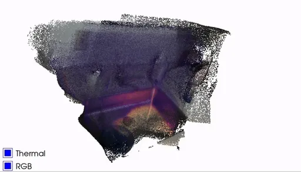
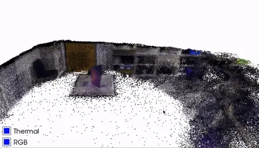
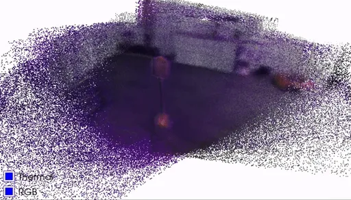
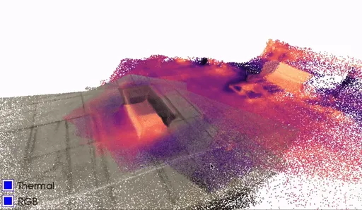

# SEAR: Simple and Efficient Adaptation of Visual Geometric Transformers for RGB+Thermal 3D Reconstruction

**Try the live demo → [SEAR demo Space](https://huggingface.co/spaces/MalcolmMielle/sear-rgb-thermal-3d)** — upload an RGB set and a thermal set, get one aligned 3D scene + camera poses, no setup.

This project aims to estimate camera poses of RGB and Thermal images together.

[](https://huggingface.co/MalcolmMielle/SEAR) | [](https://arxiv.org/abs/2603.18774) | [](https://link.springer.com/chapter/10.1007/978-3-032-37135-5_30
)

 

 

## Install

Clone this repo and [VGGT](https://github.com/facebookresearch/vggt.git)

```bash
git clone https://github.com/Schindler-EPFL-Lab/SEAR.git
cd SEAR
git clone https://github.com/facebookresearch/vggt.git
```

Install with uv:

```bash
uv sync --all-extras
```

Or install the package from PyPI (the VGGT code is vendored in the wheel):

```bash
pip install sear-rgbt
```

## Model weights

Download the SEAR checkpoints ([`MalcolmMielle/SEAR`](https://huggingface.co/MalcolmMielle/SEAR), files `SEAR_1.ckpt`–`SEAR_13.ckpt`) and the base [VGGT-1B](https://huggingface.co/facebook/VGGT-1B) weights:

```bash
hf download MalcolmMielle/SEAR --local-dir sear-weights
hf download facebook/VGGT-1B --local-dir vggt-weights
```

Run inference on a scene made of an RGB set and a thermal set (with `SEAR_2.ckpt`):

```bash
python -m sear.scripts.inference.thermal_vggt \
    --scenes_root_path /path/to/scene \
    --store_results_folder /path/to/results \
    --output_folder /path/to/cache \
    --thermal-vggt.vggt-path /path/to/vggt/weights.pth \
    --ckpt_path sear-weights/SEAR_2.ckpt
```

See the [evaluation docs](docs/evaluation/Main.md) for running the full benchmark.

## Train the model

Install VGGT checkpoint [`VGGT-1B`](https://huggingface.co/facebook/VGGT-1B).

To train our model run this script:

```bash
python sear/scripts/train_sear.py --thermal-vggt.vggt-path /path/to/vggt/weights.pth
```

Ablation studies can run by using the other aggregator-types found in `sear/ablation_models/possible_aggregators.py`.

Models can be evaluated after training with `sear/scripts/eval/ablation_vggt.py`.

To run the evaluation see the tutorials for [camera pose and point cloud](docs/evaluation/Main.md), [relative camera pose from two views](docs/evaluation/Pairs.md) and [dependence on thermal ratio](docs/evaluation/ThermalRatio.md).

## Training Data

Our training dataset is a combination of the following dataset:

* [ThermoNeRF](https://github.com/Schindler-EPFL-Lab/thermo-nerf),
* [ThermalNeRF](https://github.com/yvette256/nerfstudio-thermal),
* [ThermalMix](https://mert-o.github.io/ThermalNeRF/),
* [ThermalGaussian](https://thermalgaussian.github.io/)
* [Radar Forest](https://github.com/RNP-lab/viking_hill_radar_lidar_camera_dataset)

We provide a [compilation of all training dataset as well as ours](https://doi.org/10.5281/zenodo.19057885).

See details of the data processing in [Dataset documentation](docs/Dataset.md).

## Cite us

```bib
@inproceedings{skorokhodov2026sear,
  title={SEAR: Simple and Efficient Adaptation of Visual Geometric Transformers for Unpaired RGB-Thermal 3D Reconstruction},
  author={Skorokhodov, Vsevolod and Xu, Chenghao and Sun, Shuo and Fink, Olga and Mielle, Malcolm},
  booktitle={European Conference on Computer Vision},
  pages={542--560},
  year={2026},
  organization={Springer}
}
```
